# esbo-pfn

Early stopping Bayesian optimization for controller tuning with prior-fitted networks (PFNs). A
controller trial produces a cumulative cost trajectory `J_t` and a state trajectory. The PFNs in
this repository read the running trial (and, for the cross-trajectory models, every earlier trial
of the run) and predict a distribution over its total cost `J_T` together with the probability that
it crashes, in milliseconds. The optimizer uses these predictions to stop unpromising or crashing
trials early, to impute the total cost of stopped trials and, in the pure model loops, as the only
surrogate of Bayesian optimization. All models are trained purely on domain-randomized simulation
and are evaluated on five simulated control problems and on a real Quanser QUBE-Servo 2 Furuta
pendulum. The code accompanies the thesis *Prior Fitted Networks for Early Stopping Bayesian
Optimization in Controller Tuning* (Borchert 2026, bachelor thesis, RWTH Aachen), the source of
every number below.

<p align="center">
  <picture>
    <source media="(prefers-color-scheme: dark)" srcset="assets/hero_3d_dark.png">
    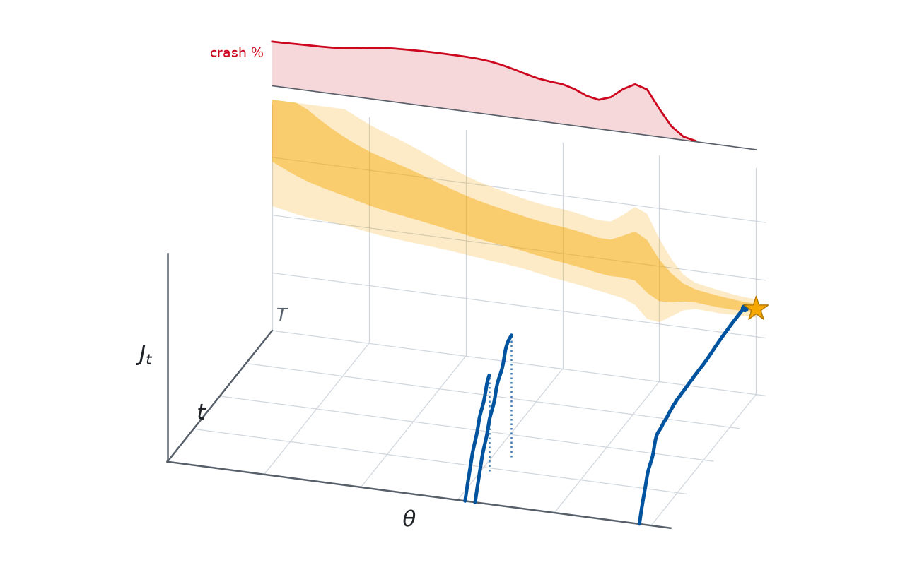
  </picture>
</p>

*Three real rig trials (blue, two of them stopped early) over time `t` and one controller coordinate
`θ`, the total cost XDecPFN predicts at `t = T` along that coordinate (orange, ±1σ and ±2σ), its
crash probability (red, back wall) and the next controller it proposes (star). One forward pass
gives the whole band, so stop decisions and proposals take milliseconds.*

## What is in here

- **Five control problems** with a universal domain-randomized prior (scaled, bounded and tied
  physical parameters, per-channel sensor noise, parameter estimates `p̂`, a degeneracy screen),
  Python simulators and fast C++ generators for every problem (`cpp/`).
- **Training data** for every model as seeded, chunked, resumable pools (`pfn data`).
- **Four own predictors** with crash-aware output heads: XDecPFN, FT-PFN, DecPFN and LC-PFN, plus
  the variants DecPFN-no-St, LC-PFN-last and the no-dead-time Furuta models, on one shared training
  core, and the LC-PFN/DecPFN hyperparameter search (`pfn train`, `pfn hpo`).
- **Baselines**: the Segment-GPs of ESBO-GP, Trajectory-TabPFN and Segment-TabPFN on the released
  TabPFN-3 regressor.
- **Every optimization strategy** of the thesis: ESRS, BO, ESBO-GP, ESBO-Oracle, ESBO-T-TabPFN,
  DecPFN, DecPFN-H and the pure model loops XDecPFN-PI/EI and FT-PFN-EI/PI.
- **Benchmarks** for prediction, optimization, timing, priors and generation speed, each unit stored
  once in a SQLite database (`pfn bench`), and one plot group per thesis figure (`pfn plot`).
- **The rig stack**: websocket client and server (`--plant qube` or a simulated rig), the reset
  between trials, a resumable rig field and the hardware prediction benchmark (`pfn hw`).
- **A Slurm layer**: any command becomes a job or a job array with `pfn submit`, everything
  cluster-specific lives in one profile file.
- **Importers** for the thesis results, rig logs and checkpoints (`pfn import`, `pfn hw import-*`).

## The five problems

| Problem | Id | Controller | `d` | `T` | `dt` | Horizon | Can crash | Success criterion |
|---|---|---|---|---|---|---|---|---|
| Boiler | `boiler` | bang-bang burner, turn-on delay | 1 | 701 | 2 s | 1400 s | no | no |
| Three-Tank | `threetank_pi` | outer-loop PI | 2 | 476 | 0.2 s | 95 s | no | no |
| PT2 dead-time | `pt2_deadtime` | PID with derivative filter | 3 | 501 | 0.1 s | 50 s | yes | no |
| Cartpole | `cartpole` | PD on cart and pole | 4 | 1000 | 0.02 s | 20 s | yes | no |
| Furuta | `furuta` | energy swing-up with arm barrier, then LQR | 8 | 600 | 1/120 s | 5 s | yes | pendulum within 5° over the last 2 s |

`d` is the number of controller parameters, `T` the number of logged steps and `dt` the logged step.
Each optimization run gets `N_max = 3·15·min(d,4)` trials and `T_budget = 15·T·min(d,4)` steps,
whichever binds first. The numbers live in `src/esbopfn/configs/problems.yaml`.

<p align="center">
  <picture>
    <source media="(prefers-color-scheme: dark)" srcset="assets/problems_strip_dark.png">
    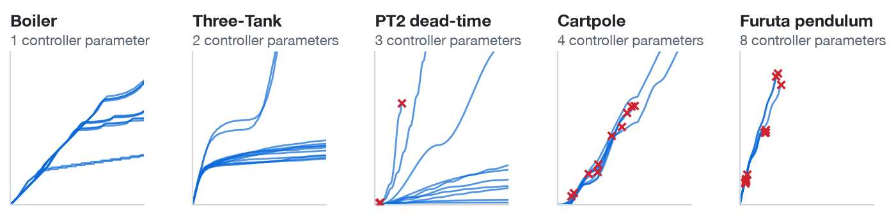
  </picture>
</p>

*Cumulative cost of 12 random controllers per problem on the nominal plant, red crosses mark
crashes (none on Boiler and Three-Tank, 3 on PT2 dead-time, 10 on Cartpole, all 12 on Furuta).
Crashes are the rule on the harder problems, which is why every predictor also outputs a crash
probability.*

## Predictors

All own models output a crash-aware distribution: 1000 bars over the total cost plus one atom for
"crashes", trained with the matching negative log-likelihood. They are trained once per problem on
prior samples and never see data of the target system.

**XDecPFN** (cross-trajectory decoder PFN, introduced in the thesis). Stage 1 is a causal decoder
over the tokens of one trajectory: cumulative cost, cost increment, the measured state channels and
the summed rates at each grid point. Its last token, plus embeddings of the controller and of the
status (complete, cut or crashed), becomes one token per trial. Stage 2 attends bidirectionally
across all trials of the run and answers queries for cut trials and for unrun controllers, so one
model serves early stopping, imputation and acquisition. Stage 1 is cached per trajectory, which
keeps an update at `O(n² + N_grid²)`. XDecPFN bins `ln J`, has 11 M parameters and is trained on
132,400 screened trajectory pools, each reused 256 times.

<p align="center">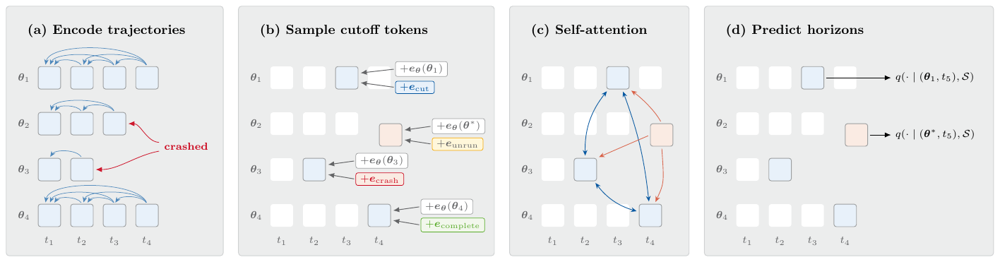</p>

*XDecPFN training (thesis figure): (a) the causal stage 1 encodes every trajectory up to its crash,
(b) cut, crash, complete and unrun embeddings are added to the last tokens, (c) stage 2
self-attention never attends to the unrun queries, (d) the head predicts the horizon cost of cut
trials and unrun controllers.*

**FT-PFN** (adapted from the freeze-thaw PFN of Rakotoarison et al. 2024). A PFN encoder over the
tokens `((θ_i, t_l), J_{t_l})` of every trial on an 8-point grid, with a learned embedding for the
crash value, and queries at the horizon of truncated trials and of 16 unrun controllers. It works on
raw `J`, has 13 M parameters and is trained on 3,500,000 freshly drawn trajectory sets, at the same
training compute as XDecPFN on Cartpole (about 2·10¹⁷ FLOPs).

**DecPFN** (decoder PFN, single trajectory). A causal decoder over the same per-trajectory tokens as
XDecPFN stage 1 that predicts the total cost from every prefix in one pass and needs no other
trials. **DecPFN-no-St** drops the state channels. **LC-PFN** is the learning-curve PFN of
Adriaensen et al. 2023 with the crash-aware head, which sees only `(t, J_t)`.

<p align="center">
  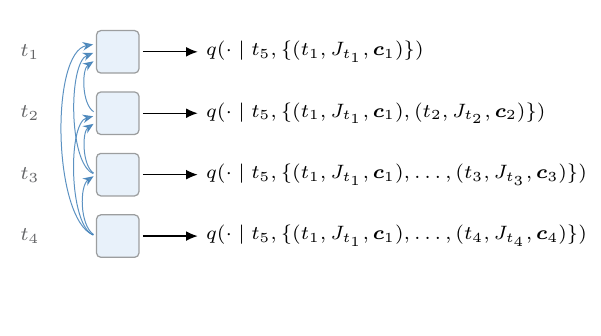
  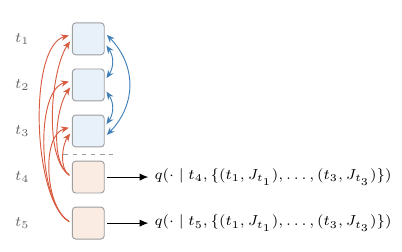
</p>

*DecPFN (left) predicts the horizon from every causal prefix in one pass. LC-PFN (right) splits a
curve into context points and queries at the remaining grid steps.*

<p align="center">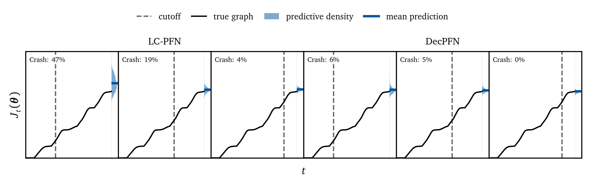</p>

*LC-PFN (left three panels) and DecPFN (right three panels) with the imported thesis weights on one
Cartpole trial cut at 35, 65 and 85 % of the horizon, each panel showing the predicted density of
the total cost right of `T` and the predicted crash probability in its corner.*

**Baselines.** **Segment-GP** is the predictor of ESBO-GP (Stenger et al. 2025), one exact GP per
segment between observed trial lengths. **Trajectory-TabPFN** and **Segment-TabPFN** use the
released TabPFN-3 regressor without any training. Details in [docs/PREDICTORS.md](docs/PREDICTORS.md),
[docs/TRAINING.md](docs/TRAINING.md) and [docs/CROSS_TRAJECTORY.md](docs/CROSS_TRAJECTORY.md).

## Strategies

| Id | Strategy | Stops on | Surrogate |
|---|---|---|---|
| `esrs` | uniform random search | `exceed` (cost already above the incumbent) | none |
| `bo` | Bayesian optimization, MES acquisition | never | objective GP |
| `esbo-gp` | ESBO with Segment-GP virtual observations | `exceed` | objective GP |
| `esbo-oracle` | ESBO with the true total cost as virtual observation | `exceed` | objective GP |
| `esbo-t-tabpfn` | ESBO with Trajectory-TabPFN (`L = 50`) | `exceed` | objective GP |
| `decpfn`, `decpfn-h` | DecPFN virtual observations (`-h`: per trial the lower-variance of DecPFN and Segment-GP) | `exceed` + `matched`, `τ = 0.9` | objective GP |
| `xdecpfn-pi`, `xdecpfn-ei` | pure model loop, closed-form PI or EI on the bars | `exceed` + `naive`, `τ = 0.99` | XDecPFN only |
| `ftpfn-ei`, `ftpfn-pi` | pure model loop | `exceed` + `naive`, `τ = 0.99` | FT-PFN only |

The `naive` rule stops when the predicted probability of ending above the incumbent exceeds `τ`,
crash mass counting as above. The `matched` rule compares the running trial with the incumbent's
own prediction at the same cutoff. See [docs/STRATEGIES.md](docs/STRATEGIES.md).

## Results

All numbers are from the thesis (Borchert 2026, bachelor thesis, RWTH Aachen), read from the
imported thesis results in the benchmark database. Every figure has a sidecar `.md` next to it with
the exact numbers it is drawn from.

<p align="center">
  <picture>
    <source media="(prefers-color-scheme: dark)" srcset="assets/results_cards_dark.png">
    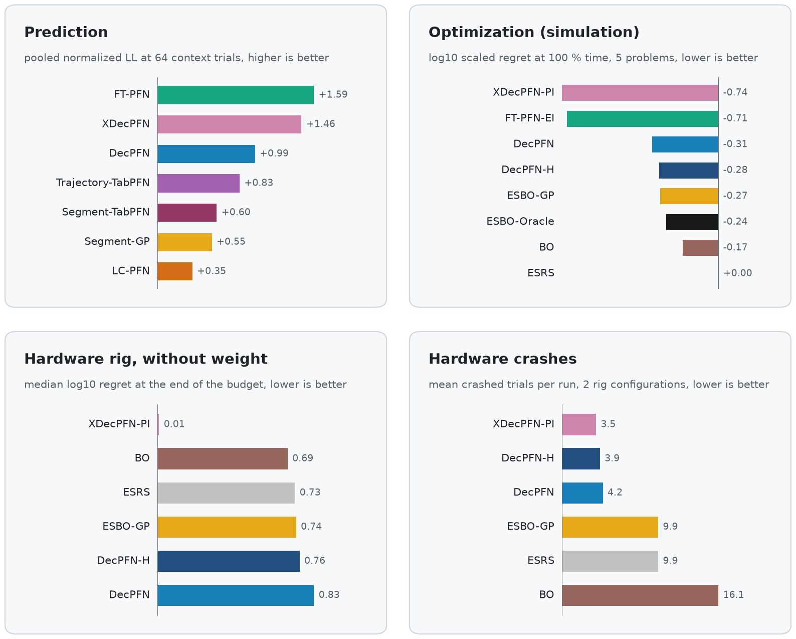
  </picture>
</p>

*Headline numbers: pooled prediction score at 64 context trials (best variant per family),
simulated optimization regret at the end of the time budget, rig regret without weight and rig
crashes averaged over both rig configurations.*

### Prediction

<p align="center">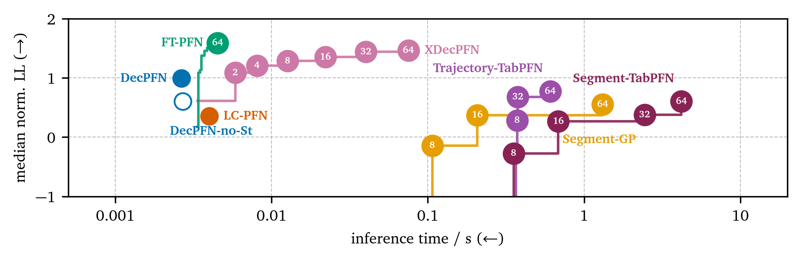</p>

*Median normalized log-likelihood of the total cost, pooled over the five problems, against
inference time per prediction on a workstation GPU, numbers are context sizes `n`. Up and left is
better: the cross-trajectory PFNs dominate, and the off-the-shelf baselines score lower at two orders
of magnitude more time than FT-PFN.*

At 64 context trials FT-PFN scores 1.59 and XDecPFN 1.46 (higher is better), the context-blind
DecPFN 0.99, Trajectory-TabPFN (`L = 50`) 0.77, DecPFN-no-St 0.60, Segment-GP 0.55 and LC-PFN 0.35.
FT-PFN predicts in 4.5 ms, XDecPFN in 75 ms, Segment-GP in 1.3 s.

<p align="center">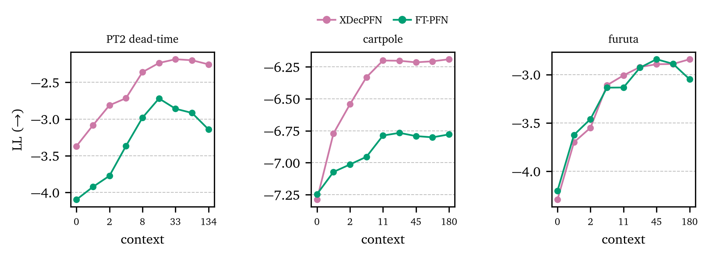</p>

*Mean conditioned log-likelihood of a fixed query as the context grows to a full run. XDecPFN keeps
improving with more context, FT-PFN degrades past 16 trials on PT2 and past 45 on Furuta and ends
0.9 (PT2) and 0.6 (Cartpole) nats behind XDecPFN.*

### Optimization in simulation

<p align="center">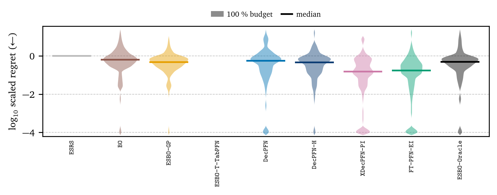</p>

*Log10 scaled regret of all 100 runs per method (5 problems, 20 plant instances each) at the end of
the simulated-time budget, where 0 is the final result of random search and lower is better. The two
pure model loops lead by a wide margin. The import holds no per-run finals of ESBO-T-TabPFN, so its
violin is empty.*

| | XDecPFN-PI | FT-PFN-EI | DecPFN | DecPFN-H | ESBO-T-TabPFN | ESBO-GP | ESBO-Oracle | BO | ESRS |
|---|---|---|---|---|---|---|---|---|---|
| log10 scaled regret at 100 % time | **−0.735** | −0.712 | −0.311 | −0.279 | −0.276 | −0.273 | −0.245 | −0.169 | 0.000 |

The table takes the per-problem median, the mean over problems and then the log10. The PFN
strategies also crash least: at the end of the budget XDecPFN-PI averages 1.80, 3.82 and 2.33
crashed trials per run on PT2 dead-time, Cartpole and Furuta, against 4.25, 14.60 and 7.60 for
ESBO-GP.

### Hardware: QUBE-Servo 2 Furuta pendulum

Six strategies, five seeds each, on two rig configurations (as shipped and with a 5 g tip mass on the
pendulum), 180 trials or 36,000 steps per run, 5 s trials at 120 Hz. All models were trained only on
the simulated Furuta prior. Regret is unscaled, `log10(J⁻ − J_best)` with `J_best` the best cost
recorded on that rig, and wall-clock time is reset-normalized.

<p align="center">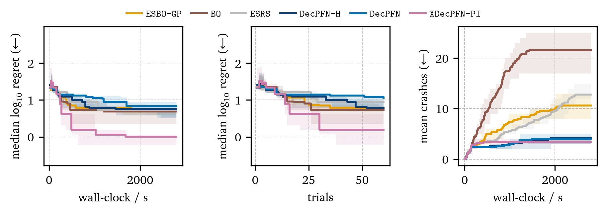</p>
<p align="center">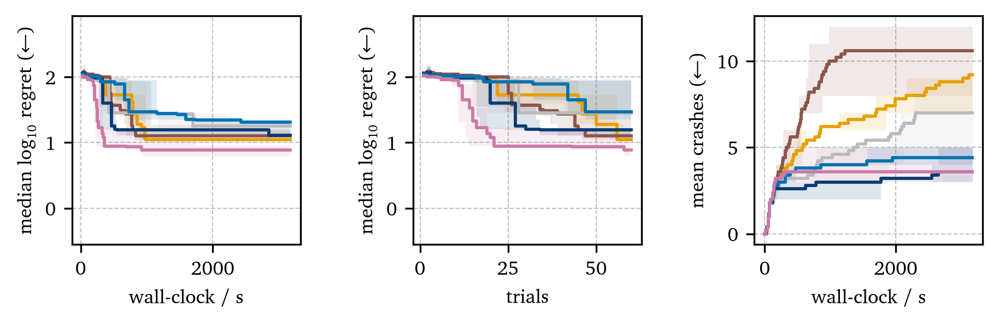</p>

*Without weight (top) and with weight (bottom): (a) median log10 regret over wall-clock, (b) over
the first 60 trials, (c) mean number of crashed trials. XDecPFN-PI reaches the lowest regret on both
rigs and crashes as rarely as the two DecPFN strategies.*

| Rig | | XDecPFN-PI | DecPFN | DecPFN-H | ESBO-GP | BO | ESRS |
|---|---|---|---|---|---|---|---|
| without weight | median final log10 regret | **0.008** | 0.832 | 0.755 | 0.737 | 0.692 | 0.730 |
| | mean crashed trials | 3.4 | 4.0 | 4.2 | 10.6 | 21.6 | 12.8 |
| with weight | median final log10 regret | **0.887** | 1.315 | 1.114 | 1.044 | 1.102 | 1.254 |
| | mean crashed trials | 3.6 | 4.4 | 3.6 | 9.2 | 10.6 | 7.0 |

What the rig showed: with five seeds per cell the spread between seeds is wide, and the clear win
belongs to XDecPFN-PI (0.68 below the next median without weight, 0.16 with weight). DecPFN and
DecPFN-H did not beat ESBO-GP on final regret on the rig. Their benefit there is safety: they cut
the crashed trials to between a third and a half of ESBO-GP's, while BO crashed most (14 to 30
trials per run without weight).

<p align="center">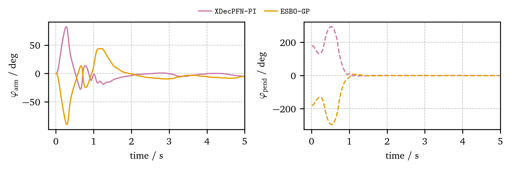</p>

*Arm and pendulum angle of the incumbent after 500 s on the median seed, rig with weight. Both
controllers swing up within about 1 s. The XDecPFN-PI controller (cost 265.7) then keeps the arm
within about 20° of center, the ESBO-GP controller (cost 310.2) overshoots by about 45° with the arm
and needs about 2 s to settle.*

<p align="center">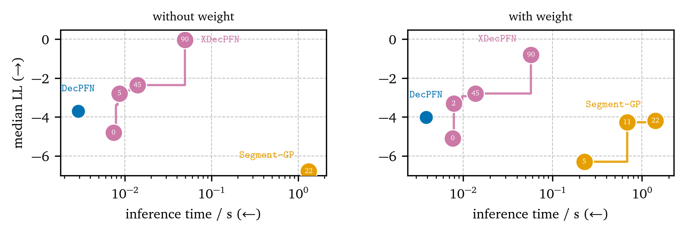</p>

*Median log-likelihood of the total cost of rig trials against inference time, numbers are context
sizes. Without any rig context XDecPFN (`n = 0`, −4.81) already beats Segment-GP at every context
size on the rig without weight, and DecPFN (3 ms per prediction) beats Segment-GP everywhere.*

## Reproduce

```bash
git clone https://github.com/tonyborchert/esbo-pfn.git esbo-pfn && cd esbo-pfn
uv sync                                    # Python 3.12 environment
uv run pfn doctor                          # torch device, compilers, BLAS, checkpoints, binaries
uv run pfn data build                      # C++ generators into $PFN_HOME/bin (--blas openblas|mkl)
uv run pfn checkpoints download tabpfn     # TabPFN-3 weights for the TabPFN baselines

uv run pfn data gen --for train decpfn --problem cartpole
uv run pfn train decpfn --problem cartpole           # -> decpfn/cartpole/binned/1M
uv run pfn bench run prediction_summary              # every unit the figure group needs
uv run pfn plot prediction_summary                   # -> $PFN_HOME/figures/prediction_summary/
```

Everything is written under `PFN_HOME` (default `./out`). Every command is seeded and resumable,
and a finished unit is never computed twice.

On a Slurm cluster (an RWTH CLAIX profile ships with the repository, another cluster is one copied
YAML file), set the profile and the two account variables once and wrap any command in `pfn submit`:

```bash
export PFN_PROFILE=rwth_claix
export PFN_SLURM_ACCOUNT_CPU=<cpu project> PFN_SLURM_ACCOUNT_GPU=<gpu project>
pfn submit --kind gen --array 0-49 -- pfn data gen --for train ftpfn --problem furuta
pfn submit --kind train -- pfn train xdecpfn --problem furuta
pfn submit --kind bench --array 0-299 --cpus 1 -- pfn bench run optimization --kind optimization
```

On the rig, start `pfn hw serve --plant qube` on the workstation with the QUBE, then run
`pfn hw run --rig without_weight` and `pfn hw bench-pred --rig without_weight`. `--plant sim` runs the
whole field against a simulated rig.

[docs/REPRODUCE.md](docs/REPRODUCE.md) walks from an empty machine to every figure, with compute
estimates. All documentation is indexed in [docs/README.md](docs/README.md).

## Repository layout

```
src/esbopfn/
  problems/      five problems, universal prior, Python simulators
  generators/    pools, datasets, wrappers of the C++ binaries, generation speed
  predictors/    prediction types, GP, Segment-GP, TabPFN baselines, lcpfn/ decpfn/ xdecpfn/ ftpfn/
  training/      shared training core, heads, normalization, model registry, HPO
  strategies/    ESBO loop, stop rules, GP-based strategies, pure model loops
  benchmarks/    database, instances, task tables, metrics, kinds/, thesis importers
  hardware/      rig client and server, reset, rig field runner, prediction benchmark
  plots/         one module per figure group, thesis style, README art
  cluster/       profiles and Slurm job rendering
  commands/      one module per pfn subcommand
  configs/       problems, datasets, rigs, hparams/, benchmarks/, cluster/
cpp/             C++ generators (furuta_gen, cartpole_gen, plants_gen) with CMake
tests/           unit/, cpp/, gpu/, hardware/, golden rollouts, fixtures
docs/            documentation, indexed in docs/README.md
assets/          README images, figures/ holds rendered thesis figures with their sidecars
```

## Thesis artifacts and imports

The thesis results, rig logs and checkpoints are not part of this repository. Where they are
available, the importers load them into the same database and model tree with
`provenance: thesis`, so every figure group draws from them and from new runs alike.

- `pfn import thesis-results --from <thesis project root> [--raw DIR]` reads the plant instances,
  the prediction task tables, the context-ladder scores, the per-query inference timings and the
  aggregated series behind the prediction and optimization figures, and with `--raw` the per-run
  optimization records.
- `pfn import thesis-models --from DIR` imports the thesis checkpoints, served by small legacy
  classes that reproduce their original forward pass: XDecPFN and FT-PFN as
  `xdecpfn/<p>/thesis/default` and `ftpfn/<p>/thesis/default`, and DecPFN, DecPFN-no-St and LC-PFN
  as `decpfn/<p>/thesis-<head>/<size>` and so on, from the export written by
  `tools/export_thesis_single_trajectory.py` ([docs/LEGACY_MODELS.md](docs/LEGACY_MODELS.md)).
- `pfn hw import-logs <run tree>` and `pfn hw import-pred <results dir>` load the rig runs (60 runs,
  8,208 trials) and the hardware prediction scores.
- The TabPFN baselines need the gated TabPFN v3 regressor `tabpfn-v3-regressor-v3_default.ckpt` in
  `$PFN_HOME/checkpoints/tabpfn/`. `pfn checkpoints download tabpfn` fetches it after a one-time
  license acceptance (`TABPFN_TOKEN`), `--from FILE` copies a local copy.

[docs/BENCHMARKS.md](docs/BENCHMARKS.md) and [docs/FIGURES.md](docs/FIGURES.md) list which figure
renders from which import.

## Testing

```bash
uv run pytest -q                               # unit tests, seconds on a laptop
uv run pytest --run-cpp                        # C++ parity and distribution tests (after pfn data build)
uv run pytest --run-gpu                        # tiny training runs on CUDA or MPS
uv run pytest tests/hardware --run-hardware    # against a running rig server
```

Tests marked `cpp`, `gpu`, `slurm` or `hardware` skip unless the resource is found or the flag is
given.

## Citation

If you use this code, please cite the thesis and the software ([CITATION.cff](CITATION.cff)):

```bibtex
@thesis{borchert2026esbopfn,
  author = {Tony Borchert},
  title  = {Prior Fitted Networks for Early Stopping Bayesian Optimization in Controller Tuning},
  type   = {Bachelor thesis},
  school = {RWTH Aachen University},
  year   = {2026}
}
```

## License

MIT, see [LICENSE](LICENSE). The TabPFN weights and the optional QUBE driver `gym_brt`
(BlueRiverTech) are third-party software under their own licenses and are not distributed here.
