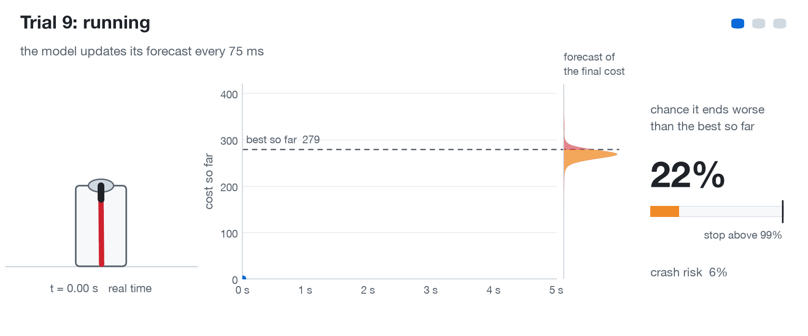
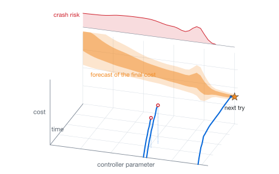
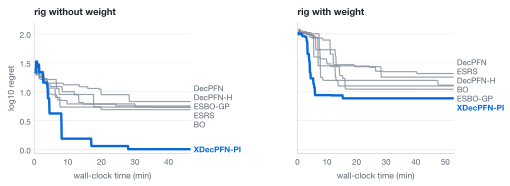
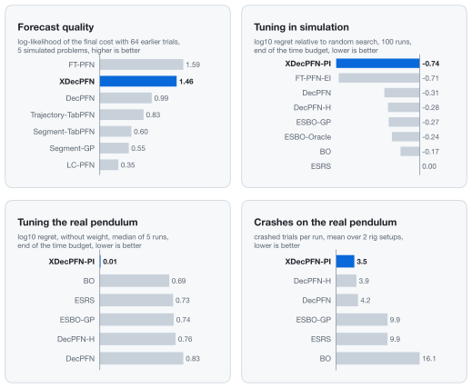
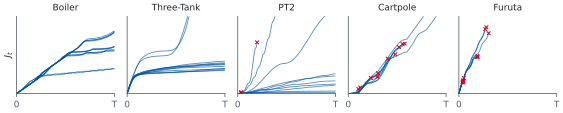

# esbo-pfn

[](https://github.com/tonyborchert/esbo-pfn/actions/workflows/ci.yml)
[](pyproject.toml)
[](LICENSE)

<h3 align="center">Stop bad controller trials before they finish.</h3>

Tuning a controller means running trial after trial on the plant. Most trials end worse than the
best one so far, and some crash. This repository contains a transformer that watches the running
trial together with every earlier trial of the tuning run, forecasts its final cost in
milliseconds and stops the trial once it is 99% sure that it will end worse than the best so far.

<p align="center">
  <picture>
    <source media="(prefers-color-scheme: dark)" srcset="assets/stop_demo_dark.gif">
    
  </picture>
</p>

<sub>Three logged trials of the real Quanser QUBE-Servo 2 Furuta pendulum, replayed through the
model. After a stop the dotted line shows how the logged trial actually continued.</sub>

## How it works

<p align="center">
  <picture>
    <source media="(prefers-color-scheme: dark)" srcset="assets/hero_3d_dark.svg">
    
  </picture>
</p>

- **Watch.** A trial logs its cost while it runs (blue). The model reads the running trial and
  every earlier trial of the run, cut short or not.
- **Forecast.** One forward pass returns a full distribution over the final cost (orange) and the
  chance that the trial crashes (red).
- **Decide.** Stop the running trial when it is almost surely worse than the best so far. The
  same forecast for untried controllers picks the next one to try (star).

The model is trained only on simulated, randomly perturbed plants and never sees data of the
target system. In the code and the docs it is called **XDecPFN** (cross-trajectory decoder
prior-fitted network), and the tuning loop built on it is **XDecPFN-PI**.

## Results

On the real pendulum XDecPFN-PI found the best controllers on both rig setups (as shipped and
with a 5 g tip mass) and crashed the fewest trials on average. Five runs per method and setup.

<p align="center">
  <picture>
    <source media="(prefers-color-scheme: dark)" srcset="assets/rig_progress_dark.svg">
    
  </picture>
</p>

<p align="center">
  <picture>
    <source media="(prefers-color-scheme: dark)" srcset="assets/results_cards_dark.svg">
    
  </picture>
</p>

<sub>All numbers come from the thesis results in the benchmark database. Each image has a
sidecar `.md` in [`assets/`](assets) with the exact values.</sub>

## Quickstart

```bash
git clone https://github.com/tonyborchert/esbo-pfn.git esbo-pfn && cd esbo-pfn
uv sync && uv run pfn doctor                                 # Python 3.12 environment, device check
uv run pfn data build                                        # C++ trajectory generators
uv run pfn data gen --for train xdecpfn --problem cartpole   # simulated training runs
uv run pfn train xdecpfn --problem cartpole                  # one GPU
uv run pfn bench run optimization --problem cartpole --set "optimization.strategies=[xdecpfn-pi]"
```

[docs/REPRODUCE.md](docs/REPRODUCE.md) goes from an empty machine to every figure, locally or on
a Slurm cluster.

## Also in this repository

<p align="center">
  <picture>
    <source media="(prefers-color-scheme: dark)" srcset="assets/problems_strip_dark.svg">
    
  </picture>
</p>

- **Five control problems** (above) with a domain-randomized prior, Python simulators and fast C++
  generators: [problems](src/esbopfn/problems/README.md), [DATA.md](docs/DATA.md)
- **More predictors**: the single-trajectory DecPFN, DecPFN-no-St and LC-PFN, the
  cross-trajectory FT-PFN, and the Segment-GP and TabPFN-3 baselines:
  [TRAINING.md](docs/TRAINING.md), [CROSS_TRAJECTORY.md](docs/CROSS_TRAJECTORY.md),
  [PREDICTORS.md](docs/PREDICTORS.md)
- **Tuning strategies**: random search, BO, ESBO-GP, ESBO-Oracle, ESBO-T-TabPFN, DecPFN, DecPFN-H
  and the model loops: [STRATEGIES.md](docs/STRATEGIES.md)
- **Rig stack** for the QUBE-Servo 2 (server, client, reset between trials, resumable runs):
  [HARDWARE.md](docs/HARDWARE.md)
- **Benchmark database** for prediction, optimization, timing and priors, with one plot group per
  thesis figure: [BENCHMARKS.md](docs/BENCHMARKS.md), [FIGURES.md](docs/FIGURES.md)
- **Slurm layer** that turns any command into a job or a job array: [CLUSTER.md](docs/CLUSTER.md)

All documentation is indexed in [docs/README.md](docs/README.md).

## Citation

The code accompanies the thesis *Prior Fitted Networks for Early Stopping Bayesian Optimization in
Controller Tuning*. If you use it, please cite the thesis and the software
([CITATION.cff](CITATION.cff)):

```bibtex
@thesis{borchert2026esbopfn,
  author = {Tony Borchert},
  title  = {Prior Fitted Networks for Early Stopping Bayesian Optimization in Controller Tuning},
  type   = {Bachelor thesis},
  school = {RWTH Aachen University},
  year   = {2026}
}
```

## License

MIT, see [LICENSE](LICENSE). The TabPFN weights and the optional QUBE driver `gym_brt`
(BlueRiverTech) are third-party software under their own licenses and are not distributed here.

The code base and its documentation were developed with the help of AI coding assistants
(Claude) and reviewed by the author.
